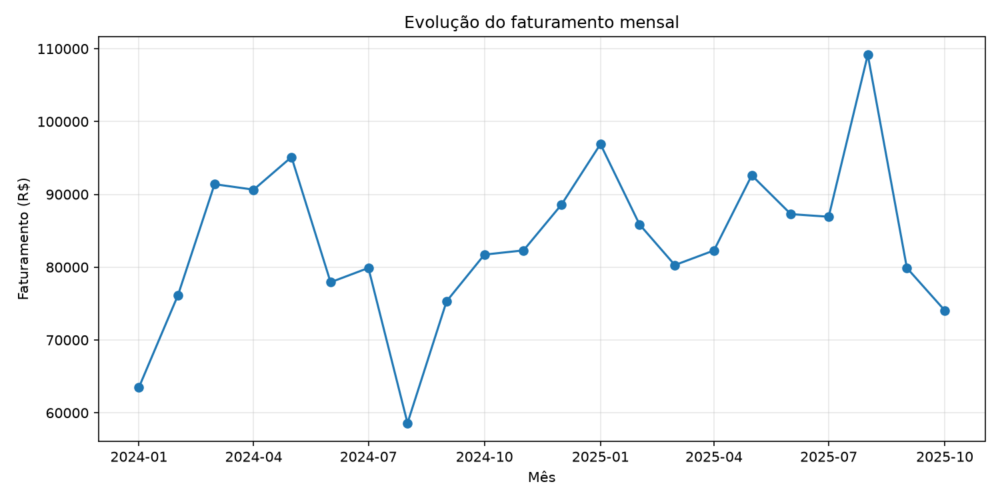
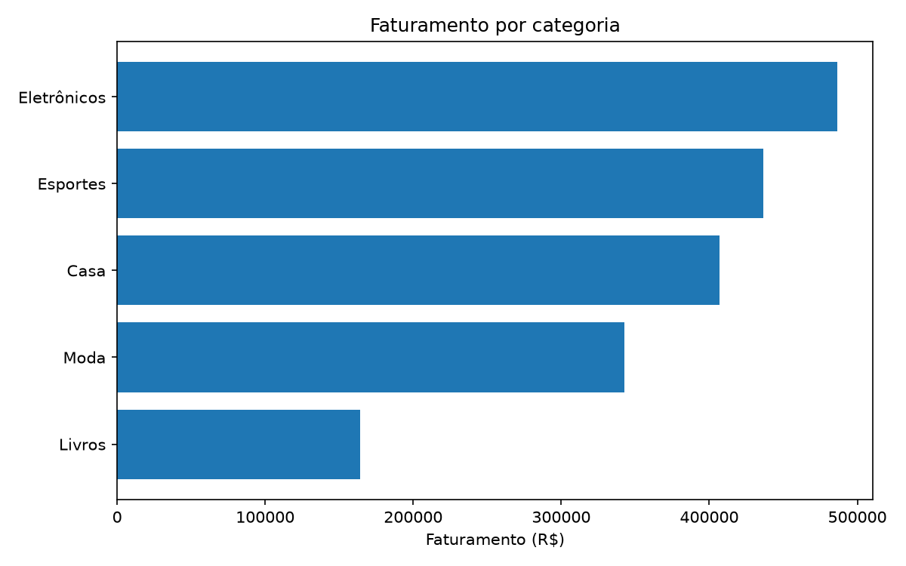
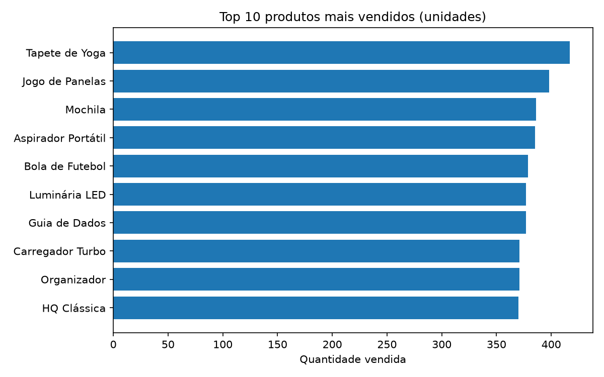
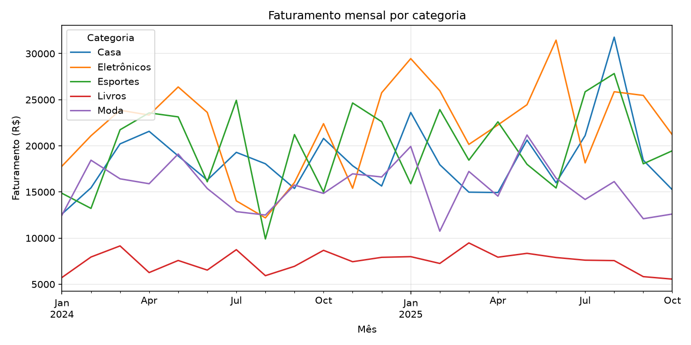

# Análise de Vendas e Comportamento de Clientes

Análise de uma loja de varejo **fictícia** usando SQL (PostgreSQL) e Python (Pandas). O projeto calcula faturamento, ticket médio, desempenho por categoria, evolução mensal e melhores clientes, e **valida cada resultado de SQL com um cálculo independente em Pandas**.

> Os dados são totalmente fictícios, gerados por script com `seed(42)` (reprodutíveis).

## Objetivo

Responder perguntas de negócio de varejo com consultas SQL e exploração em Pandas, mostrando que os números das duas abordagens são idênticos.

## Tecnologias

- PostgreSQL e SQL (JOIN, GROUP BY, agregações, subconsultas, CTEs, window function)
- Python 3, Pandas, SQLAlchemy, psycopg2
- Matplotlib / Seaborn (gráficos)
- Faker (dados fictícios) e python-dotenv 
- Git e GitHub

## Estrutura do projeto

```
analise-vendas-clientes/
├── sql/
│   ├── 01_criar_tabelas.sql     # criação das tabelas, PKs e FKs
│   └── 02_consultas.sql         # consultas de negócio
├── python/
│   └── gerar_dados.py           # gera e insere os dados fictícios
├── notebooks/
│   ├── 01_exploracao.ipynb      # importação, tratamento e análise em Pandas
│   ├── 02_graficos.ipynb        # gráficos
│   └── 03_validacao.ipynb       # validação SQL x Pandas
├── data/                        # CSVs de exemplo
├── docs/img/                    # gráficos usados no README
├── requirements.txt
├── .env.example
├── .gitignore
└── README.md
```

## Modelo de dados

```
clientes ──< pedidos ──< itens_pedido >── produtos
```

| Tabela | Colunas principais |
|---|---|
| `clientes` | id_cliente (PK), nome, email, cidade, estado, data_cadastro |
| `produtos` | id_produto (PK), nome, categoria, preco |
| `pedidos` | id_pedido (PK), id_cliente (FK), data_pedido, status |
| `itens_pedido` | id_item (PK), id_pedido (FK), id_produto (FK), quantidade, preco_unitario |

Volume gerado: 500 clientes, 40 produtos (5 categorias), 3.000 pedidos e 7.562 itens, de jan/2024 a out/2025.

**Regra de faturamento:** soma de `quantidade * preco_unitario` apenas de pedidos com status diferente de `cancelado`.

## Configuração do PostgreSQL

1. Instale o PostgreSQL e o pgAdmin 4.
2. No pgAdmin, crie o banco `vendas_db`.
3. Abra a Query Tool e execute `sql/01_criar_tabelas.sql`.
4. Copie `.env.example` para `.env` e preencha `DB_PASSWORD` com a sua senha.

## Como executar

```
python -m venv venv
venv\Scripts\activate
pip install -r requirements.txt
python python/gerar_dados.py
```

Depois, execute os notebooks em ordem: `01_exploracao`, `02_graficos` e `03_validacao`. As consultas SQL estão em `sql/02_consultas.sql`.

## Perguntas de negócio e respostas

**1. Qual o faturamento total e o ticket médio?**
Faturamento de R$ 1.836.430,20 em 2.794 pedidos (sem cancelados), com ticket médio de R$ 657,28.

**2. Qual categoria gera mais receita?**

| Categoria | Faturamento | Participação |
|---|---|---|
| Eletrônicos | R$ 486.358,40 | 26,48% |
| Esportes | R$ 436.502,20 | 23,77% |
| Casa | R$ 406.784,10 | 22,15% |
| Moda | R$ 342.466,10 | 18,65% |
| Livros | R$ 164.319,40 | 8,95% |

**3. Como o faturamento evolui mês a mês?**
O melhor mês foi ago/2025 (R$ 109.171,30) e o pior foi ago/2024 (R$ 58.588,70). O faturamento oscila bastante de um mês para o outro, sem tendência clara de alta ou queda. Out/2025 (R$ 74.066,30) pode estar incompleto, pois os dados terminam em outubro.

**4. Quais os 10 produtos mais vendidos (unidades)?**
Tapete de Yoga (417), Jogo de Panelas (398), Mochila (386), Aspirador Portátil (385), Bola de Futebol (379), Guia de Dados (377), Luminária LED (377), Carregador Turbo (371), Organizador (371) e HQ Clássica (370). Há empates nas posições 6-7 e 8-9.

**5. Quem são os 10 melhores clientes?**
O maior gasto foi do cliente 86 (R$ 11.068,80), seguido pelo 344 (R$ 10.903,30) e pelo 388 (R$ 10.655,50). Os 10 primeiros ficam entre R$ 8.510,00 e R$ 11.068,80.

## Principais descobertas

- Eletrônicos lidera em receita (26,48%) e Livros é a menor categoria (8,95%).
- Categorias de maior preço unitário pesam mais na receita do que o volume sozinho sugere.
- Dos 3.000 pedidos, 2.794 não foram cancelados (206 cancelados); isso muda o faturamento, por isso o filtro é aplicado em todas as consultas.
- O produto mais vendido em unidades (Tapete de Yoga) não é de uma categoria de ticket alto, e a ordem por quantidade difere da ordem por receita.

## Validação SQL x Pandas

O notebook `03_validacao.ipynb` executa cada consulta SQL e o cálculo equivalente em Pandas e compara com `assert`. Resultado: diferença de **0,00** em faturamento, pedidos, ticket médio, categorias, faturamento mensal, top 10 produtos e top 10 clientes.

## Gráficos






## Próximos passos

- Análise de recorrência e retenção de clientes
- Segmentação RFM
- Painel interativo (ex.: Power BI ou Streamlit)